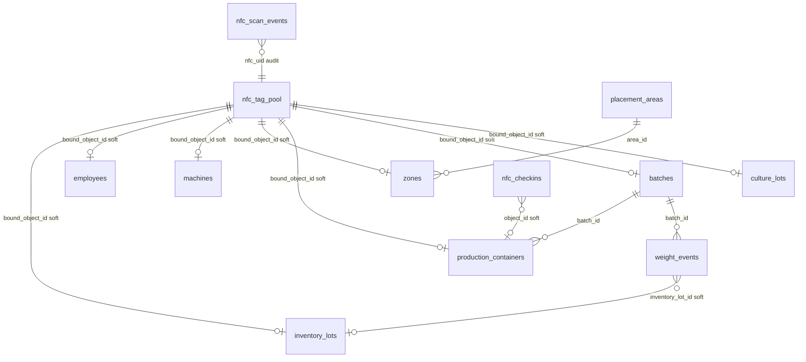

# NFC / tag identity schema (Communifarm SQLite)

Schema version: **19** (see `custom_components/communifarm/storage/sqlite_db.py`).

## Truth rules

| Rule | Detail |
| --- | --- |
| Chip vs DB | NDEF / chip payload may **seed** identity on first write/bind. After that, **SQLite is source of truth**. |
| Dual-write | Domain rows keep `nfc_uid`. `nfc_tag_pool` is the physical-tag **registry** (`status`, `bound_object_id`, `bound_object_type`). Bind/unbind updates **both**. |
| No cycles | Pool points at objects by soft TEXT ids. Objects **never** FK back to the pool. |
| Resolve default | Last-NFC / Tag source UID → entity `nfc_uid` walk → fill `nfc_session` / sensors from DB. |
| Scan side effects | Every resolve appends `nfc_scan_events` (audit + context). **No** auto qty/location mutation without an explicit service. |

## Resolve order (first match wins)

1. `production_containers.nfc_uid`
2. `batches.stable_id` then `batches.nfc_uid`
3. `culture_lots.nfc_uid`
4. `media_batches.nfc_uid`
5. `inventory_lots.nfc_uid`
6. `employees.nfc_uid`
7. `machines.nfc_uid`
8. `zones.nfc_uid`
9. else `unknown` / not found

`nfc_tag_pool` is **not** the resolve walk; it is updated on bind and aligned when already `bound`.

## ERD (UML)

No edge from domain tables back to `nfc_tag_pool` (avoids circular references).

## Tables (NFC-touching)

### Registry / audit

| Table | PK | NFC columns | Soft refs | Notes |
| --- | --- | --- | --- | --- |
| `nfc_tag_pool` | `id` / `stable_id` | `nfc_uid` UNIQUE(site,uid) | `bound_object_id`, `bound_object_type`, `shipment_id`, `site_id` | Registry; `intended_type`, `status` available\|bound\|reserved |
| `nfc_scan_events` | `id` / `stable_id` | `nfc_uid` | `object_type`, `object_id`, `site_id` | Append-only resolve audit (v19) |
| `nfc_checkins` | `id` / `stable_id` | `nfc_uid` | `object_type`, `object_id`, `zone_id` | Explicit activity check-in |

### Domain rows with `nfc_uid`

| Table | `nfc_uid` | Other |
| --- | --- | --- |
| `inventory_lots` | nullable + index | amount / purchase cols; `ndef_payload` |
| `employees` | nullable + index | `ndef_payload` |
| `machines` | nullable + index | `ndef_payload` |
| `zones` | nullable + index | `ndef_payload`; under `placement_areas` |
| `production_containers` | NOT NULL UNIQUE | `batch_id`, `zone_id`, flush/phase |
| `batches` | NOT NULL (often = stable_id) | mix/production hub |
| `culture_lots` | nullable | lineage / zone |
| `media_batches` | nullable | media hub |
| `weight_events` | optional snapshot | also `inventory_lot_id` |

## Dual-write helper

Application code: `nfc_actions.async_dual_write_pool_bind` → `NfcTagPoolRepository.async_dual_write_bind` (`domain/nfc_bind.PoolBindTarget`).

Call after every successful entity `nfc_uid` assignment (`bind_nfc`, `confirm_nfc_write`, `register_production_block`, shipment seed for pre-bound chips).

## Scan → session fill

`resolve_nfc` always:

1. Walks entity tables.
2. Inserts `nfc_scan_events` (`source`: resolve / bind / confirm_write / …).
3. Aligns pool **only if** pool row is already `bound` and pointers drifted.
4. Updates `nfc_session` (label, zone, amount left for inventory, …) for HA sensors.

## Intake process modes (dashboard chrome)

Same `/communifarm/intake` path; `select.communifarm_intake_process_mode`:

| Mode | Shows |
| --- | --- |
| `combined` (default) | Mark tags + purchase (bootstrap) |
| `mark_tags` | Shipment / scanner / write targets only |
| `purchase_intake` | Asset purchase only |

## Agent skill

Keep this document in sync when migrations or NFC bind paths change: `.agents/skills/nfc-database/SKILL.md`.
